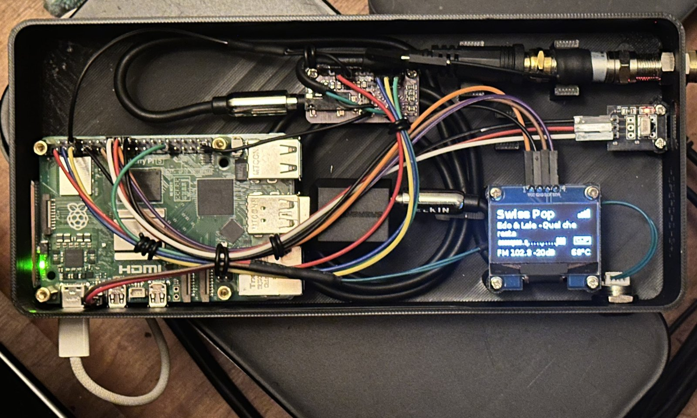
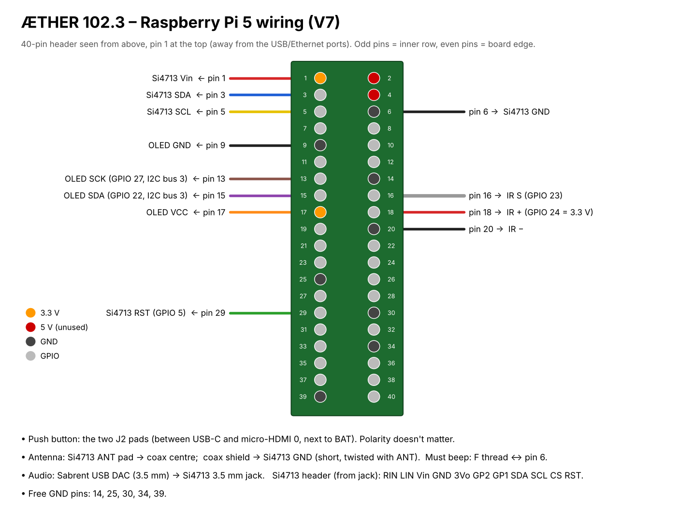
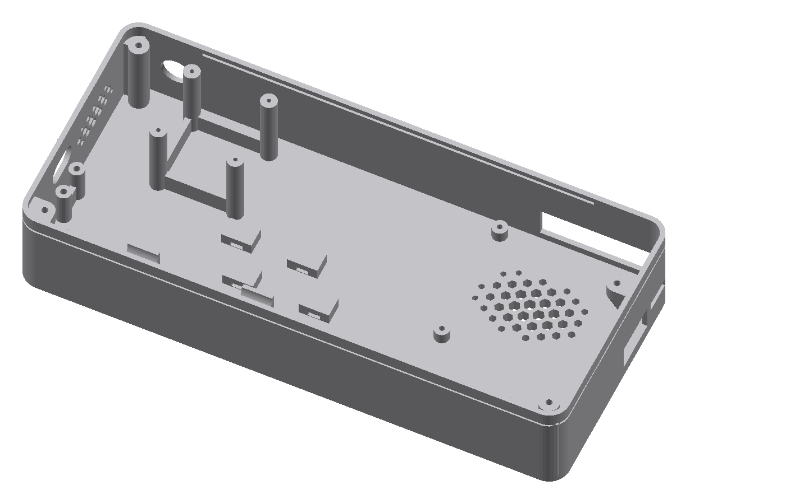
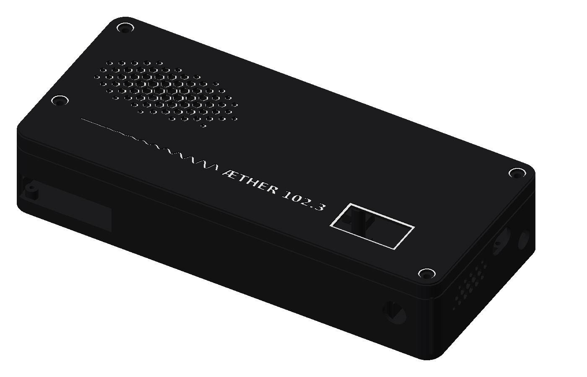
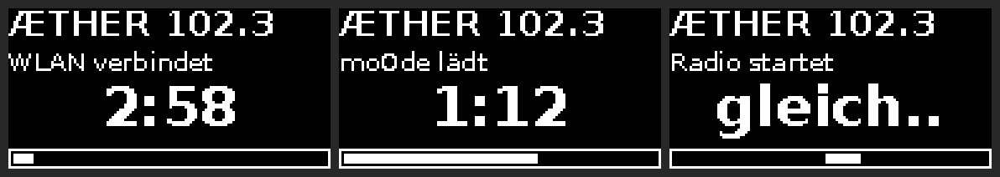
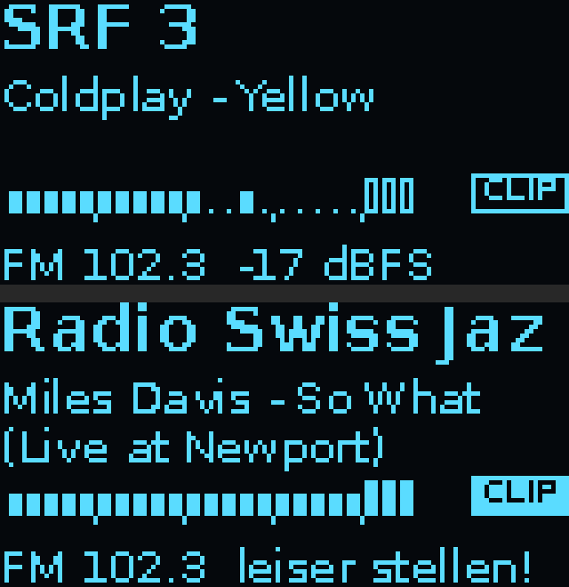

# ÆTHER 102.3 – FM webradio for a vintage Bang & Olufsen receiver

A Raspberry Pi 5 plays internet radio (moOde) and a Si4713 FM transmitter feeds it **by cable** into the FM antenna input of a vintage Bang & Olufsen system. It was designed for a B&O 9300 and now runs at home with a BeoCenter 9500. The receiver keeps its original look and controls but gets a modern, stable station list. Everything sits in a 3D-printed enclosure with an OLED display, an IR remote and a single push button.



## Why I built it

At home, ÆTHER 102.3 feeds a **Bang & Olufsen BeoCenter 9500** whose fixed installation still runs through the house: kitchen, bathroom and living room. FM stations have been disappearing, but the wiring, the speakers and the beautiful control panel are all still there. With this box they're useful again. Press one button and the radio plays, in every room, exactly as it did in the 1990s.

There's some irony in it. It took a Raspberry Pi 5, two I²C buses, an FM transmitter chip, a self-monitoring daemon, a learned boot countdown and a couple of thousand lines of Python and CAD code to get back to what Bang & Olufsen did perfectly decades ago: **one button, and it just plays.** Progress, it turns out, is mostly about finding your way back to simplicity.

## Features

- **Internet radio → FM 102.3 MHz** over coax and attenuators into the receiver: no antenna on air, minimal transmit power.
- **1.3" OLED:** station, title, cassette-deck-style level meter with CLIP lamp, WiFi bars and CPU temperature.
- **IR remote** (17-key NEC set): start/stop, volume, next/previous station, favourites 1–5, system info page.
- **One push button** on the Pi 5 power header (J2). Short press starts or stops, holding for 5 s shuts the Pi down, and a short press turns it back on.
- **Boot countdown:** the display shows progress and a learned countdown from a few seconds after power-on until the station plays.
- **Self-monitoring, plug & play:** auto-start of a station, stream watchdog, automatic carrier-off after 50 s of silence, WiFi reconnect, I²C error recovery, power-supply and temperature warnings, hardware watchdog, and protection against reboot loops.
- **Diagnostics page** at `http://webradio.local:8080`: live status, log and remote buttons, plus a built-in self-test.
- **Digital twin:** an interactive 3D model of the enclosure, components and colour-coded wiring, with a fault simulator ([twin/](twin/)).

## How it works

```
Internet ─► Raspberry Pi 5 (moOde) ─► Sabrent USB DAC ─3.5 mm─► Si4713 FM module
                    │ I²C bus 1 (control)            │ ANT (coax)
                    │ I²C bus 3 → OLED               ▼
                    │ GPIO 23 ← IR receiver   10 dB attenuator ─► F socket ─► F→IEC cable ─► B&O 9300 FM input
                    └ J2 ← push button
```

The Si4713 runs at its minimum power (88 dBµV), and the attenuator brings the level down further. The signal goes into the receiver by cable and is not meant to be radiated. See the [Disclaimer](#disclaimer): operating an FM transmitter may require approval.

## Bill of materials

| Part | Notes |
| --- | --- |
| Raspberry Pi 5 (4 GB) + microSD (A2 recommended) | moOde audio player |
| USB-C power supply, 5 V | Official 27 W recommended. A 5 V / 3 A supply works (USB is then limited to 600 mA). |
| Sabrent USB audio adapter | Audio output into the Si4713 |
| Adafruit-style Si4713 FM transmitter breakout (purple, 11-pin header) | I²C address 0x63 |
| 1.3" OLED SH1106, I²C, 4-pin (VCC GND SCK SDA) | Address 0x3C |
| KY-022 IR receiver + 17-key NEC remote | Remote uses a CR2025 coin cell |
| 12 mm momentary push button | Wired to the Pi 5 J2 pads |
| Goobay F attenuator 10 dB, F bulkhead socket, F→IEC cable | Short coax from the Si4713 ANT pad |
| Dupont jumpers female–female | Black, white, purple, blue, green, yellow, orange, red, brown |
| M2 heat-set inserts (≈3.2 mm OD, 5 mm long), M2 screws | All screw points in the enclosure |
| Optional: Raspberry Pi Active Cooler or heatsink | The Pi runs at about 58 °C without one |

## Wiring



| From | Pi pin | Wire colour |
| --- | --- | --- |
| Si4713 Vin | 1 (3.3 V) | red |
| Si4713 GND | 6 | black |
| Si4713 SDA | 3 | blue |
| Si4713 SCL | 5 | yellow |
| Si4713 RST | 29 (GPIO 5) | green |
| OLED VCC | 17 (3.3 V) | orange |
| OLED GND | 9 | black |
| OLED SCK | 13 (GPIO 27, I²C bus 3) | brown |
| OLED SDA | 15 (GPIO 22, I²C bus 3) | purple |
| IR receiver S | 16 (GPIO 23) | white |
| IR receiver + (middle pin) | 18 (GPIO 24, driven high = 3.3 V) | red |
| IR receiver − | 20 | black |
| Push button | **J2 pads** (between USB-C and micro-HDMI 0, next to BAT). Do **not** use the VID pads. | – |

**Si4713 header**, counted from the 3.5 mm jack: `RIN · LIN · Vin · GND · 3Vo · GP2 · GP1 · SDA · SCL · CS · RST`. Only Vin, GND, SDA, SCL and RST are used.

**Antenna:** solder the coax centre conductor to the ANT pad, and the coax **shield to the Si4713 GND pin**. Keep both short and twisted together.

**Check with a multimeter before powering up:**
- The F socket thread ↔ Pi pin 6 must beep.
- The F socket centre ↔ GND must not beep.
- Pi pin 1 ↔ pin 6 must not beep.

> The coax shield **must** be grounded. Without it the antenna tuning wanders (8–47 pF), and RF couples into the I²C wires and causes `Remote I/O error`s.

## Enclosure (V7)

| File | Use |
| --- | --- |
| [cad/print/AETHER_V7_Unterteil_P1S.3mf](cad/print/) | Base, ready for Bambu Lab P1S (AMS slot 3, black PLA) |
| [cad/print/AETHER_V7_Deckel_P1S.3mf](cad/print/) | Lid with flush inlay. The lid is in slot 3 (black), the text and signal wave in slot 2 (white). |
| [cad/print/AETHER_V7_Seitendeckel_P1S.3mf](cad/print/) | Snap-in cover for the large opening on the narrow side |
| `cad/print/*.stl` | The same parts as STL for any slicer |
| `cad/step/*.step` | STEP (faceted) for CAD |
| `cad/source/` | Python source of the enclosure (custom CSG), STEP/3MF converters and the digital-twin builder |

**Design:**
- Honeycomb ventilation with a gradient.
- Two-colour lid ("ÆTHER 102.3" plus a signal wave as a flush inlay).
- The OLED, IR receiver, button and all modules are mounted in the base, so the lid only snaps on.
- The Pi sits on towers and is screwed from above.
- The front exposes only the USB-C port.
- The IR receiver looks through a window in the side wall.
- The single 10 dB attenuator lies in an open V-support with a cable-tie tunnel, which absorbs tolerances. The space in front of it is kept free for the long black F plug.
- The Si4713 board sits behind the attenuator chain, not underneath the F plug, so there's room for the coax and the wires.

**Printing:**
- PLA, 0.2 mm layers, 3 walls, 15–20 % infill, no supports.
- Print the lid upside down.
- The base has a 3 mm floor and a chamfered bottom edge against warping.

**Heat-set inserts:** M2 (≈3.2 mm OD, up to 6 mm long). The holes are Ø 3.2 × 6 mm with a Ø 3.6 lead-in, plus a wider Ø 3.6 pocket below the insert so displaced PLA has room and doesn't clog the hole. The bosses are Ø 6.8 mm. Press the inserts in with a soldering iron at about 220 °C.

| Preview | |
| --- | --- |
|  |  |

## Software

### First installation (on the Pi)

1. Flash **moOde audio player** with Raspberry Pi Imager:
   - Hostname `webradio`, your user name and WiFi.
   - Enable SSH.
2. In moOde (`http://webradio.local`):
   - Output device: **USB audio (Sabrent)**.
   - **Metadata file: ON**.
   - **Auto-play: ON**.
   - Volume type: software.
   - Mark up to 5 favourite stations.
3. Copy the `software/` folder to the Pi and install:
   ```bash
   scp -r software <user>@webradio.local:~/
   ssh <user>@webradio.local
   cd ~/software && bash install.sh && sudo reboot
   ```

`install.sh` does the following:
- Enables I²C at **50 kHz**.
- Adds a second I²C bus (bus 3) for the OLED.
- Enables the IR receiver (gpio-ir on GPIO 23, power from GPIO 24).
- Sets up the J2 button handling, the fan curve, a Python venv and the services `fm` and `aether-boot`.
- Allows passwordless self-recovery (sudoers) and enables the hardware watchdog.

### Updating from a Mac (one command)

`tools/aether-update.sh` copies the newest `AETHER_software_update*.zip` from `~/Downloads` to the Pi, installs it and reboots. To install it once:

```bash
cp tools/aether-update.sh ~/ && chmod +x ~/aether-update.sh
echo "alias aether-update='~/aether-update.sh'" >> ~/.zshrc && source ~/.zshrc
```

For password-free SSH, run `ssh-copy-id <user>@webradio.local` once. To build an update ZIP from this repo: `cd software && zip -j ~/Downloads/AETHER_software_update.zip *`

### Settings (top of `software/fm.py`)

| Setting | Value | Note |
| --- | --- | --- |
| `FREQUENZ_KHZ` | 102300 | 102.3 MHz. Pick a frequency that is free where you live. |
| `LEISTUNG` | 88 | Si4713 minimum, enough with one 10 dB attenuator (range 88–115) |
| `STILLE_S` | 50 | Carrier off after 50 s of silence |
| `FAVORITEN` | `[]` | Empty = the first 5 moOde favourites |
| `LAUT_SCHRITT` | 2 | Volume step in % per key press |
| I²C speed | 50 kHz | Set in `install.sh` (`I2C_HZ`) |

### Remote control (preset NEC codes in `ir_tasten.json`)

| Key | OK | ▶ / ◀ | ▲ / ▼ | 1–5 | 0 |
| --- | --- | --- | --- | --- | --- |
| Function | Start/Stop | Next / previous station | Volume + / − | Favourite 1–5 | System info (CPU, RAM, temperature, voltage, WiFi) |

For a different remote, run `sudo systemctl stop fm; ~/fm-env/bin/python ~/ir_lernen.py; sudo systemctl start fm` and press Enter to keep a key's existing mapping.

### Display

| Boot countdown | Playing |
| --- | --- |
|  |  |

The boot countdown learns how long the Pi takes to start (moOde starts its player about 3 minutes after boot). If it takes longer than expected, it shows "gleich…" instead of counting into negative numbers.

### Self-monitoring

| Situation | Reaction |
| --- | --- |
| FM module not found at start | Display shows "FM-Modul fehlt", retries every 10 s (no reboot) |
| Occasional I²C glitch | Reads again; restarts the chip after 3 failures in a row |
| Stream stalls or stops unexpectedly | Restarts the stream after 15 s |
| No station loaded after boot | Starts playback or favourite 1 after 20 s |
| 50 s of silence | Switches the carrier off and back on when sound returns |
| No internet | Shows a countdown; reconnects WiFi after 2 min, reboots after 10 min (at most once per 30 min) |
| moOde / mpd not answering | Message only (moOde restarts its player itself) |
| Weak power supply / undervoltage / > 80 °C | Warning on the display |
| `fm.py` crashes | systemd restarts it (never reboots the whole Pi) |
| Whole system hangs | Hardware watchdog reboots after 15 s |

### Diagnostics page and self-test

`http://webradio.local:8080` shows:
- Live status: station, level, carrier, antenna capacitance, temperature, WiFi, error counters.
- The last 150 log lines.
- One button per remote function.

| URL | Purpose |
| --- | --- |
| `/status.json` | Machine-readable status |
| `/log?n=300` | Plain-text log |
| `/selbsttest?start=1&dauer=300` | Self-test: triggers every function, then runs a 5-minute soak test. Open `/selbsttest` to read the report. |
| `/leistung?wert=100` | Temporarily changes the transmit power (88–115) until restart |
| `/antenne?pf=20` | Sets a fixed antenna capacitance in pF (`pf=0` = automatic). Add `&speichern=1` to keep it. Useful because the chip's auto-tuning can pick poor values when it feeds a 75 Ω cable. |

The page is only reachable in your home network. It can operate the radio but cannot run system commands.

Logs on the Pi: `journalctl -u fm -f`

## Troubleshooting (lessons learned)

| Symptom | Cause / fix |
| --- | --- |
| `No I2C device at address 0x63` | Si4713 wiring. Check the pin order printed on the board. The chip may need a reset pulse: `pinctrl set 5 op dl; pinctrl set 5 op dh; i2cdetect -y -r 1` |
| `Remote I/O error` while transmitting, antenna C jumping | Coax shield not grounded. Solder the shield to the Si4713 GND. |
| Button press only causes an I²C error | The button is on the **VID** pads. Move it to **J2**. |
| Remote does nothing, log full of "unknown IR code" | Missing battery, or the IR receiver has no supply (pin 18 must read 3.3 V). Only the NEC protocol is enabled to suppress noise. |
| Display stuck on "moOde lädt …" | moOde metadata file off or no station loaded. fm.py now reads directly from mpd and auto-starts a station. |
| Level around −69 dB, only noise on the receiver | Nothing is playing, or the wrong output device is selected in moOde. |
| Receiver hears only noise although the Pi transmits | Check the cable path. Test with a portable FM radio next to the box. Try another F→IEC cable. |
| Noise comes and goes without any log event | Probably the Si4713's automatic antenna tuning, which is unreliable into a 75 Ω cable. Once it works, read `antenne_pf` from `/status.json` and lock it with `/antenne?pf=<value>&speichern=1` (stored in `~/.aether_antenne`, applied after every restart). |
| Slow boot | moOde starts mpd about 3 minutes after boot. A faster A2 microSD card helps. |

## Digital twin

[twin/index.html](twin/) is a three.js viewer of the enclosure and all components. It includes:
- Every part and every cable, each switchable.
- A working OLED.
- A virtual remote.
- A clickable push button.
- A fault simulator (WiFi loss, clipping, hung process, undervoltage, …) with a VU meter, voltmeter and CPU chart.

Serve the folder over HTTP (for example `python3 -m http.server` inside `twin/`) or enable GitHub Pages, because it loads `aether_v7.json`.

## Disclaimer

> **Operating an FM transmitter may require approval.** In many countries, including Switzerland (BAKOM/OFCOM), the EU, the UK and the US (FCC), transmitting on the FM band is regulated and may need a licence or approval. It may also be prohibited altogether, even at very low power or over a cable. Check the rules that apply where you live **before** building or operating this device, and choose a frequency that does not interfere with licensed broadcasters.

This project is published for **information and educational purposes only**. It is provided **"as is", without any warranty**. The author accepts **no responsibility or liability** for any damage, injury, interference, legal consequences, fines or other losses arising from building, modifying or operating it. Working with mains-powered equipment, soldering and RF electronics is at your own risk. By using any part of this project, you accept full responsibility for its use and for compliance with all applicable laws and regulations.

## Licence

MIT © Oliver Grassmann – see [LICENSE](LICENSE). Code comments are partly in German.
